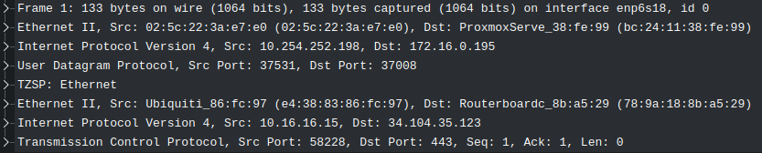

# Clean a capture file of TZSP

A MikroTik sniffer stream captured as-is (e.g. with `tshark -f "udp port 37008"`)
contains every sniffed frame wrapped in Ethernet + IP + UDP + TZSP headers:



To analyse the original traffic, those outer headers need to be removed. This
folder contains two tools that do that to an existing capture file, plus notes
on a quick-and-dirty `editcap` alternative.

To capture and strip in one step instead, see
[`../tzsp_ng_capture`](../tzsp_ng_capture/README.md).

## Tools

| Tool | Input | Output | Notes |
|------|-------|--------|-------|
| [`tzsp_strip_rs`](tzsp_strip_rs/README.md) | pcap or pcapng | pcap | Fastest. Port fixed at 37008. |
| [`tzsp_strip_py`](tzsp_strip_py/README.md) | pcap or pcapng | pcapng | Port configurable with `-p`. Reports skipped packets. |

Both tools parse each packet (Ethernet → IPv4 or IPv6 → UDP → TZSP, including TZSP
tagged fields) and only write the inner frame. Packets that aren't valid
TZSP, or don't parse cleanly, are skipped instead of being written still
wrapped.

### Shared limitations

- **No IPv6 extension headers.** TZSP over IPv4 and IPv6 are both handled, but
  for IPv6, UDP must directly follow the IPv6 header.
- **Ethernet input only.** The input must use the Ethernet link type. A capture
  taken with `tshark -i any` uses Linux cooked (SLL) framing, and every packet
  will be skipped without a warning.
- **No VLAN tags.** If the capture host saw the stream on a tagged trunk, the
  packets are skipped.
- **No IP reassembly.** If the router's TZSP datagrams were fragmented, the
  first fragment is written truncated and the remaining fragments are skipped.

## Using rust

Test using a 1GB pcap file:

```bash
time ./target/release/tzsp_strip_rs input.pcap output.pcap
Done. Extracted packets are in output.pcap

real    0m3.677s
user    0m0.639s
sys     0m2.790s
```

Pros:
* Quite fast.
* Actually parses packets as a sanity check.

## Using Python

The Python tool uses scapy only to read and write the capture file. It parses
the headers directly from the raw bytes, using the same logic as the Rust tool.
An earlier version built scapy's full layer objects for every packet and took
about 13 minutes on the same 1GB file. The current version is roughly 50×
faster.

Pros:
* Easy to modify.
* Logs progress and how many packets were skipped.

Cons:
* Still slower than the Rust tool.

## Using editcap

The Ethernet + IP + UDP + TZSP header *should* not change in size over the
course of a capture. For a minimal TZSP header (4 fixed bytes + END tag) the
header lengths are:

* IPv4: 14 + 20 + 8 + 5 = **47** bytes
* IPv6: 14 + 40 + 8 + 5 = **67** bytes

So an alternative method is to blindly chop that many bytes off the beginning of
each packet:

```bash
time editcap -C 47 <input file>.pcap <output file>.pcap

real    0m2.855s
user    0m0.607s
sys     0m2.188s
```

Pros:
* Extremely fast, since it doesn't parse the packets at all.

Cons:
* If the header length changes for any reason (IP options, extra TZSP tags,
  non-TZSP packets in the capture), editcap keeps cropping blindly and the
  output is corrupted.

## Alternative projects

* [tzsp2pcap](https://github.com/thefloweringash/tzsp2pcap)
